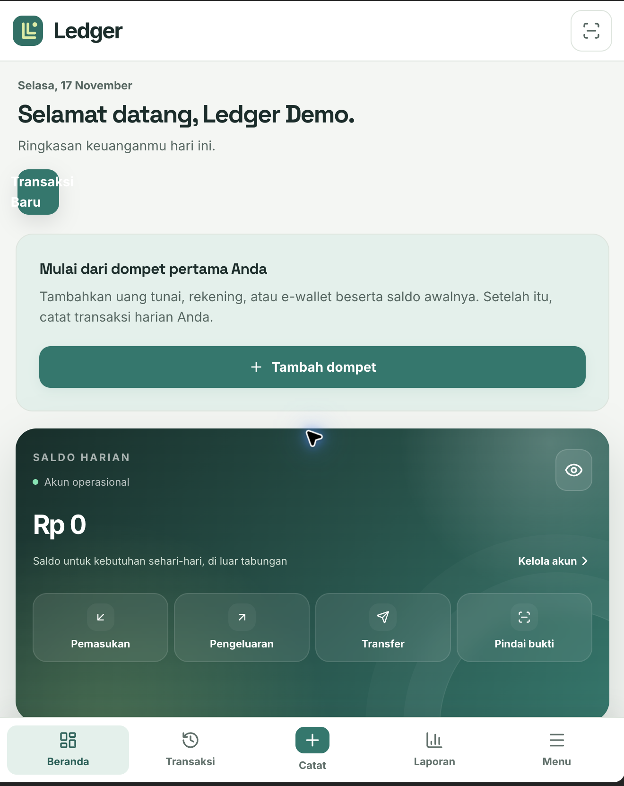
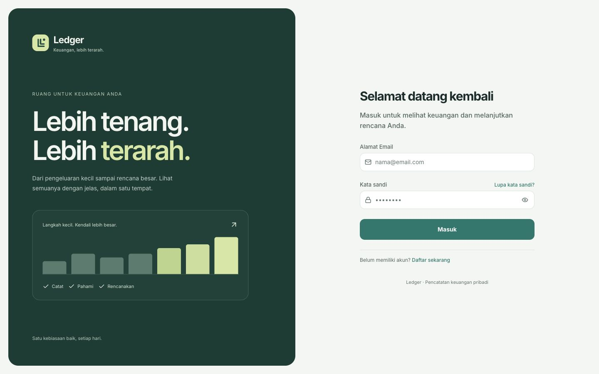
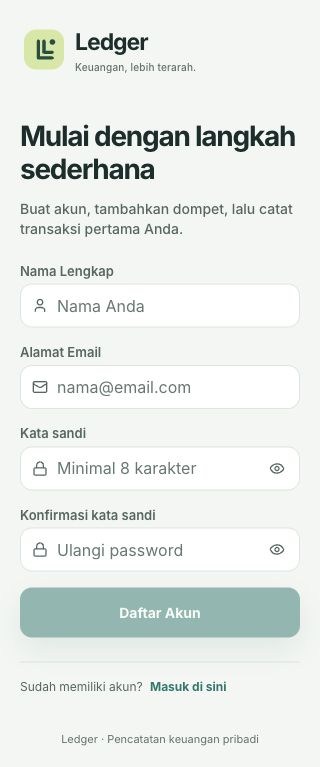

# Ledger

**Ledger** adalah aplikasi pencatatan keuangan pribadi untuk membantu pengguna mencatat transaksi, memahami arus kas, dan merencanakan tujuan keuangan dari satu tempat. Proyek ini dibangun sebagai SPA Vue 3 dengan API Laravel.


## Tampilan

<p align="center">
  
</p>
<p align="center"><em>Dashboard — tampilan seluler</em></p>

<p align="center">
  
</p>
<p align="center"><em>Halaman masuk — tampilan desktop</em></p>

<p align="center">
  
</p>
<p align="center"><em>Halaman pendaftaran — tampilan ponsel</em></p>

## Fitur

- **Transaksi:** catat pemasukan, pengeluaran, dan transfer; cari, filter, edit, hapus, serta ekspor riwayat transaksi.
- **Dompet dan kategori:** kelola akun tunai, bank, dan dompet digital beserta kategori transaksi.
- **Anggaran:** tetapkan batas pengeluaran bulanan dan pantau pemakaian per kategori.
- **Target keuangan:** kelola target, rincian biaya, kontribusi, kewajiban, dan alokasi dana tunai maupun aset.
- **Aset dan investasi:** catat transaksi emas dan RDPU, nilai aset, alokasi ke target, serta lihat ringkasan kekayaan bersih.
- **Laporan:** tinjau ringkasan bulanan, kategori pengeluaran, dan arus kas.
- **Tagihan:** kelola tagihan berulang dan pembayaran otomatis yang dijadwalkan.
- **Pindai bukti:** ekstrak informasi dari gambar struk menjadi draft transaksi yang bisa diperiksa sebelum disimpan.
- **Keuangan bersama:** undang anggota untuk mengelola dana, target, dan aset bersama.
- **WhatsApp:** hubungkan WhatsApp untuk mencatat transaksi melalui pesan.
- **PWA:** dapat dipasang di perangkat dan menerima gambar melalui fitur berbagi sistem operasi.
- **Navigasi SPA:** perpindahan menu menggunakan Vue Router tanpa memuat ulang seluruh dokumen. Halaman dimuat terpisah agar bagian yang tidak dibuka tidak ikut masuk ke bundle awal.

## Fitur unggulan

### Target yang terhubung ke uang dan aset

Target keuangan dapat memuat rincian biaya, kewajiban, dan kontribusi. Pengguna bisa mengalokasikan saldo kas atau kuantitas aset ke target, lalu melihat progres dari biaya yang sudah dibayar, kas yang dialokasikan, dan nilai aset secara terpisah. Saldo yang belum diselesaikan—misalnya pencairan RDPU yang masih menunggu—tidak dihitung sebagai kas siap pakai.

### Pelacakan investasi yang mengikuti status transaksi

Ledger mencatat pembelian dan penjualan emas maupun RDPU, termasuk biaya transaksi, jumlah unit/gram, dan status penyelesaian. Nilai investasi dapat diperbarui dengan harga beli kembali emas atau NAB RDPU. Pembelian aset tetap terhubung dengan arus kas, sehingga pokok investasi tidak tercampur dengan pengeluaran konsumsi.

### Catat transaksi dari pesan WhatsApp

Quick Add memahami pesan seperti `makan 35rb gopay` atau `transfer 50rb bca ke gopay`. Transaksi ditinjau dan dikonfirmasi sebelum dicatat; pesan webhook yang sama juga dideduplikasi agar percobaan ulang tidak membuat transaksi ganda. Parser Gemini tersedia melalui endpoint OpenAI-compatible; konfigurasi `DEVFLOW_AI_*` mengatur model, endpoint, dan API key.

### Struk menjadi draft, bukan transaksi otomatis

Pindai bukti mengirim gambar struk ke OCR dan menyusun data transaksi sebagai draft. Pengguna tetap bisa memeriksa dan memperbaiki tanggal, nominal, akun, serta kategori sebelum menyimpan transaksi.

### Tagihan berulang dan pembayaran terjadwal

Tagihan dapat diatur berulang mingguan, bulanan, atau tahunan. Pembayaran otomatis menggunakan akun yang dipilih, mencatat transaksi pengeluaran, dan menandai kondisi yang perlu perhatian—misalnya saldo tidak cukup. Scheduler Laravel memprosesnya setiap hari pada pukul 00.05 waktu Jakarta.

### Ruang keuangan bersama

Undang anggota ke workspace bersama untuk mencatat kontribusi dan penarikan, mengelola target serta aset bersama, dan membagi alokasi. Aktivitas workspace memiliki riwayatnya sendiri.

### Akurasi data uang

Nilai uang di backend dihitung menggunakan representasi desimal, bukan floating point biner. Operasi finansial penting dijalankan dalam transaksi database dan mendukung idempotency key agar permintaan yang diulang tidak menggandakan pencatatan.

## Teknologi

| Bagian | Teknologi |
| --- | --- |
| Backend dan API | PHP 8.3+, Laravel 13, Laravel Sanctum |
| Frontend | Vue 3, Vue Router, Pinia, Vite 8 |
| Styling dan ikon | Tailwind CSS 4, Lucide Vue |
| Grafik | ApexCharts |
| Database | SQLite untuk pengembangan; MySQL/MariaDB juga didukung |
| PWA | Service worker dengan Workbox dan Vite PWA |

## Menjalankan secara lokal

### Persyaratan

- PHP 8.3 atau lebih baru, Composer, dan ekstensi PHP BCMath.
- Node.js 20.19+ atau 22.12+.
- SQLite (default) atau MySQL/MariaDB.
- Git.

Tesseract OCR dan ekstensi PHP GD hanya diperlukan untuk fitur pindai bukti. Integrasi WhatsApp juga bersifat opsional.

### Instalasi

```bash
git clone https://github.com/ferdykp/cashlog.git
cd cashlog
composer install
cp .env.example .env
php artisan key:generate
php -r "file_exists('database/database.sqlite') || touch('database/database.sqlite');"
```

Pastikan `.env` menggunakan `DB_CONNECTION=sqlite` untuk database lokal default. Untuk MySQL/MariaDB, isi `DB_HOST`, `DB_PORT`, `DB_DATABASE`, `DB_USERNAME`, dan `DB_PASSWORD` sesuai konfigurasi lokal.

Kemudian siapkan database dan frontend:

```bash
php artisan migrate
npm install
npm run build
```

### Menjalankan aplikasi

```bash
composer run dev
```

Perintah ini menjalankan proses pengembangan Laravel dan Vite. Buka alamat yang ditampilkan Laravel di terminal (default: `http://localhost:8000`), lalu buat akun melalui halaman **Daftar**.

Untuk hanya menjalankan build frontend produksi:

```bash
npm run build
```

Frontend menggunakan `/api` pada origin yang sama secara default. Atur `VITE_API_BASE_URL` hanya jika API berada di origin yang berbeda.

## Integrasi opsional

### Pindai bukti transaksi

Fitur OCR memerlukan PHP GD, Tesseract, dan data bahasa Inggris. Konfigurasikan `TESSERACT_BINARY` dan `OCR_TIMEOUT` jika path atau batas waktu instalasi lokal berbeda. Hasil pindai disimpan sebagai draft agar nominal dan tanggal bisa diperiksa sebelum dicatat.

Panduan lengkap: [docs/ocr.md](docs/ocr.md).

### WhatsApp

Integrasi memerlukan Evolution API dan konfigurasi `EVOLUTION_API_URL`, `EVOLUTION_API_KEY`, `EVOLUTION_INSTANCE`, serta `EVOLUTION_WEBHOOK_SECRET`. Parser Gemini dikendalikan oleh `DEVFLOW_AI_ENABLED`. Jika diaktifkan dan API key tersedia, teks pesan serta nama akun/kategori dapat dikirim ke endpoint Gemini untuk parsing.

Panduan lengkap: [docs/whatsapp.md](docs/whatsapp.md).

## Pemeriksaan

Jalankan pemeriksaan backend, frontend, dan build produksi dengan:

```bash
php artisan test
vendor/bin/pint --test
npm test
npm run format:check
npm run build
```

## Struktur proyek

```text
app/                  Logika backend, model, layanan, dan API
database/             Migrasi, factory, dan seeder
resources/js/         Aplikasi Vue, halaman, router, store, dan PWA
resources/views/      Entry point Blade untuk SPA
routes/               Route web dan API Laravel
docs/                 Panduan teknis dan catatan arsitektur
```

## Deployment

Gunakan HTTPS, penyimpanan persisten untuk database dan unggahan, serta jalankan `php artisan migrate --force` saat merilis migrasi. Scheduler Laravel perlu dijalankan setiap menit agar pemrosesan pembayaran tagihan otomatis berjalan.

Lihat [docs/deployment-monolith.md](docs/deployment-monolith.md) untuk panduan deployment dan konfigurasi server web. Informasi tentang data yang diproses tersedia di [docs/data-privacy.md](docs/data-privacy.md).
